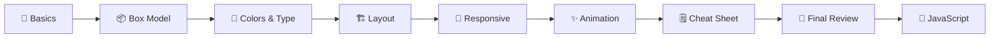

# 🎨 CSS

> The armor over the skeleton. HTML gave me the bones, CSS gives them a suit.
> **Mark II of the armor: in progress.** All the notes are written. The practice and the examples are what's left, and that's where the learning actually happens.


---

## 🎯 Why This Folder Exists

HTML built the frame ([Mark I, complete](../HTML/README.md)). This folder is me learning to paint it, align it, make it fit every screen, and make it move, so it looks like it belongs in a Stark Industries demo instead of a 1998 homepage.

My skills got rusty, so I'm rebuilding them in public, one concept at a time. Even Tony didn't start with the Mark 85. He started in a cave with a box of scraps. 🔧

**Goal:** write CSS I understand well enough to explain, not CSS I copied until it worked.

**Where it stands:** every topic has notes, there's a cheat sheet, and there's a final review with a self-test. What I have **not** done yet is the practice: all 35 challenges are unticked and none of the 3 planned examples are built. Notes aren't learning until I've built something with them, so I'm keeping the statuses honest.

> 🧠 **Honesty policy:** I'm going to get things wrong here. Mistakes go in [`notes/things-i-broke.md`](../notes/things-i-broke.md) *(coming soon)*, and the "ohhh, THAT'S how it works" moments go in [`notes/things-i-finally-understood.md`](../notes/things-i-finally-understood.md) *(coming soon)*.

---

## 🚪 Start Here

New to this folder (including future me)? Read in this order:

| Step | Open | Why |
|---|---|---|
| 1️⃣ | [`basic.md`](./basic.md) | How CSS is written: selectors, specificity, the cascade, inheritance |
| 2️⃣ | [`box-model.md`](./box-model.md) | Why everything is secretly a box |
| 3️⃣ | [`colors-and-typography.md`](./colors-and-typography.md) | Colors, units, fonts, and CSS variables |
| 4️⃣ | [`layout.md`](./layout.md) | Flexbox, Grid, and `position` |
| 5️⃣ | [`responsive-design.md`](./responsive-design.md) | Making one page work on every screen |
| 6️⃣ | [`animations.md`](./animations.md) | Transitions, transforms, and keyframes |
| 7️⃣ | [`cheat-sheet.md`](./cheat-sheet.md) | Everything above, folded into one reference |
| 8️⃣ | [`final-review.md`](./final-review.md) | Self-test, skills checklist, and what's next |
| 🔧 | [`examples/`](./examples) | Where I'll build (and break) things |

> ⚡ **In a hurry?** Skip straight to [`cheat-sheet.md`](./cheat-sheet.md). It has copy-paste snippets, a starter reset, and a debugging flowchart.



---

## 🗺️ Folder Map

| Item | What's inside | Status |
|---|---|---|
| 📖 [`basic.md`](./basic.md) | Rule anatomy, selectors, combinators, pseudo-classes, specificity, the cascade, inheritance | 📝 Notes written |
| 📦 [`box-model.md`](./box-model.md) | Content, padding, border, margin, `box-sizing`, margin collapsing, `display`, overflow | 📝 Notes written |
| 🌈 [`colors-and-typography.md`](./colors-and-typography.md) | Hex/RGB/HSL, contrast, units (`rem`, `em`, `fr`...), variables, fonts, `clamp()` | 📝 Notes written |
| 🏗️ [`layout.md`](./layout.md) | Flexbox, Grid, `position`, `z-index`, centering recipes, common patterns | 📝 Notes written |
| 📱 [`responsive-design.md`](./responsive-design.md) | Viewport tag, mobile-first, media queries, fluid techniques, images, container queries | 📝 Notes written |
| ✨ [`animations.md`](./animations.md) | Transitions, transforms, easing, keyframes, performance, `prefers-reduced-motion` | 📝 Notes written |
| 🗒️ [`cheat-sheet.md`](./cheat-sheet.md) | Quick reference, starter reset, debugging flow, next-step kit toward JavaScript | 📖 Reference |
| 🏁 [`final-review.md`](./final-review.md) | 10 self-test questions, skills checklist, progress tracker, reflection template | 🎯 Waiting on the practice |
| 🧪 [`examples/`](./examples) | Index of 3 planned examples (no example folders built yet) | 💡 Planned |

*Legend: 📝 notes written · 🔨 practiced · ✅ done · 📖 reference · 🎯 next · 💡 planned*

```
CSS/
├── README.md
├── basic.md
├── box-model.md
├── colors-and-typography.md
├── layout.md
├── responsive-design.md
├── animations.md
├── cheat-sheet.md
├── final-review.md
└── examples/
    └── README.md     ← index only; example folders get added as I build them
```

---

## 🔍 Topics at a Glance

| Topic | The one idea to remember | Practice challenges |
|---|---|---|
| 📖 Basics | Conflicts are settled by specificity first, then source order | 0 of 5 |
| 📦 Box model | Every element is content + padding + border + margin, and `border-box` makes sizes predictable | 0 of 6 |
| 🌈 Colors & type | Keep every color in a variable, use `rem` for text, check contrast (4.5 : 1) | 0 of 6 |
| 🏗️ Layout | Flexbox for one dimension, Grid for two, `position` for overlaps | 0 of 6 |
| 📱 Responsive | Viewport tag + flexible units + mobile-first `min-width` queries | 0 of 6 |
| ✨ Animation | Animate `transform` and `opacity`, and respect reduced motion | 0 of 6 |

---

## 📈 Progress Check

| Milestone | Status |
|---|---|
| Six topic notes (basics, box model, colors & type, layout, responsive, animations) | ✅ Written |
| Cheat sheet with starter reset and debugging flowchart | ✅ Written |
| Final review with 10 self-test questions | ✅ Written |
| Examples index with 3 planned projects | ✅ Written (index only) |
| Work through the 35 practice challenges | 🎯 Next |
| Build the 3 planned examples, each with its own README | 💡 Planned |
| Pass the final-review self-test from memory | 🔮 After the practice |
| Start the JavaScript folder | 🔜 Coming soon |

> 🎯 The self-test lives in [`final-review.md`](./final-review.md#-self-test-questions). When I can answer it from memory *and* I've built the examples, this folder is done.

---

## 🛠️ The Suit Upgrade Plan

| Stage | Milestone | Notes | Built |
|:---:|---|:---:|:---:|
| **1** | Style text, colors, and a basic page | ✅ | ⬜ |
| **2** | Understand the box model without crying | ✅ | ⬜ |
| **3** | Build real layouts with Flexbox and Grid | ✅ | ⬜ |
| **4** | Make everything responsive | ✅ | ⬜ |
| **5** | Add transitions and animation | ✅ | ⬜ |
| **...** | Keep iterating until it's Mark 85 🚀 | | ⬜ |

---

## 🧪 Examples

Every example will live in `examples/` in its own folder with its own README: the code **and** what I learned building it. The [examples index](./examples/README.md) has the plans, a README template, and a quality checklist.

| Example | What it teaches | Status |
|---|---|---|
| 🎧 Styled audio controller | Style the [Accessible Audio Controller](../HTML/examples/09-10-2026-FREE-Code-Camp-WORKSHOP-Accessible-Audio-Controller) from my HTML folder without breaking accessibility | 💡 Planned |
| 🖤 Brand palette with CSS variables | A dark theme built from custom properties (`--obsidian`, `--crimson`, `--ivory`) | 💡 Planned |
| 📱 Responsive card layout | Flexbox, Grid, and media queries working together | 💡 Planned |

> 💡 Bonus material: the 10 practice pages in [`HTML/examples`](../HTML/examples) have no CSS at all yet, so they're a ready-made pile of pages to style.

---

## 🧱 Principles I'm Following

- Start every stylesheet with `box-sizing: border-box`.
- Style with classes. Save IDs for links and JavaScript hooks.
- `rem` for text and spacing, `px` for borders and shadows.
- Every color lives in a CSS variable.
- Mobile-first, and let the content choose the breakpoints.
- Never remove a focus outline without replacing it.
- Animate `transform` and `opacity`, and respect `prefers-reduced-motion`.
- Open DevTools *before* guessing.

---

## 💥 Known Gremlins

Nothing in the CSS folder has been practiced yet, so there are no CSS bugs to report (yet). The honest list so far is what carries over from HTML. These pages will get styled eventually, so they need fixing first:

| Gremlin | Where | Why it matters for CSS |
|---|---|---|
| 📱 Missing `viewport` tag | Six HTML pages | Responsive design doesn't work on phones without it ([`responsive-design.md`](./responsive-design.md#-step-zero-the-viewport-meta-tag)) |
| 🎬 No `<track>` captions | Video Player | Styling won't fix missing captions |
| 📊 Headers need `scope` | Exam Table | Styled tables still need correct semantics |
| 🗓️ Raw `&` and uneven indentation | Schedule Table | Cleaner HTML is easier to style |

The full table lives in [`HTML/examples/README.md`](../HTML/examples/README.md#-honest-corner-known-gremlins). New CSS gremlins will be logged in the Gremlins table inside [`final-review.md`](./final-review.md#-gremlins--mark-ii-backlog).

---

## 📚 Where I'm Learning From

- 🏫 [freeCodeCamp: Responsive Web Design](https://www.freecodecamp.org/): my main path, picked up right after the HTML review
- 📖 [MDN Web Docs: CSS](https://developer.mozilla.org/en-US/docs/Web/CSS): the official reference I'll keep going back to
- 🗒️ More in [`notes/useful-resources.md`](../notes/useful-resources.md) *(coming soon)*

---

## 🔗 Navigation

| ⬅️ Previous | 🏠 Home | ➡️ Next |
|---|---|---|
| [HTML](../HTML/README.md) | [Learning Archive](../README.md) | JavaScript *(coming soon)* |

- 🏠 [Back to the Learning Archive](../README.md)
- 🌐 [`HTML/`](../HTML/README.md): the skeleton this folder is painting
- ⚡ `JavaScript/`: making it move *(coming soon)*
- 💥 `notes/things-i-broke.md`: where my CSS disasters will live *(coming soon)*

---

<p align="center"><i>The notes are written. Now to build something that actually looks like armor. 🦾</i></p>
