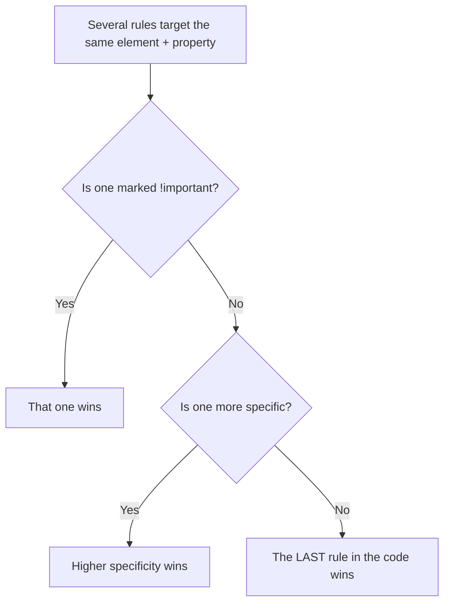

# 🧱 CSS Basics: Syntax, Selectors & the Cascade


> HTML says **what** things are. CSS says **how they look**. This file is the "how do I even talk to CSS" starter pack. 🛠️

⬅️ [Back to CSS README](./README.md) | ➡️ Next: [box-model.md](./box-model.md)

---

## 📍 Table of Contents

1. [What CSS actually is](#-what-css-actually-is)
2. [Three ways to add CSS](#-three-ways-to-add-css)
3. [Anatomy of a rule](#-anatomy-of-a-rule)
4. [Selectors](#-selectors-picking-what-to-style)
5. [Combinators](#-combinators-selecting-by-relationship)
6. [Pseudo-classes & pseudo-elements](#-pseudo-classes--pseudo-elements)
7. [Specificity](#-specificity-who-wins-a-fight)
8. [The cascade](#-the-cascade)
9. [Inheritance](#-inheritance)
10. [Common mistakes](#-gremlins-i-expect-to-meet)
11. [Practice challenges](#-practice-challenges)

---

## 🤔 What CSS Actually Is

**CSS = Cascading Style Sheets.** It's a language that tells the browser how to display HTML elements: colors, spacing, fonts, layout, animation, all of it.

```
 HTML                    CSS                      RESULT
┌──────────────┐     ┌─────────────────┐     ┌──────────────┐
│ <h1>Hello</h1>│  +  │ h1 { color: red }│  =  │  Hello  (red) │
└──────────────┘     └─────────────────┘     └──────────────┘
   structure              presentation          what you see
```

🦴 HTML = skeleton, 🎨 CSS = armor, ⚡ JavaScript = the arc reactor (later).

---

## 🔌 Three Ways to Add CSS

| Method | How it looks | When to use it |
|---|---|---|
| **External stylesheet** ✅ | `<link rel="stylesheet" href="styles.css">` | Almost always. One file styles many pages. |
| **Internal `<style>`** | `<style> p { color: blue; } </style>` in the `<head>` | Quick experiments, single-page demos |
| **Inline `style=""`** ⚠️ | `<p style="color: blue;">` | Rarely. Hard to maintain, and it beats almost everything in specificity |

### Linking an external stylesheet

```html
<head>
  <meta charset="UTF-8">
  <title>My Page</title>
  <link rel="stylesheet" href="styles.css">
</head>
```

> 💡 The `href` path is relative to the HTML file. If `styles.css` lives in a `css/` folder, write `href="css/styles.css"`. A wrong path means **no styles and no error message**, which is a classic early gremlin.

---

## 🔬 Anatomy of a Rule

```
selector        ← WHO gets styled
   │
   ▼
 h1 {
   color: crimson;        ← property: value;   (a "declaration")
   font-size: 2rem;
 }
   ▲        ▲
   │        └── value: what to set it to
   └─────────── property: what to change
```

| Part | Example | Meaning |
|---|---|---|
| Selector | `h1` | Which elements to target |
| Declaration block | `{ ... }` | Everything inside the curly braces |
| Property | `color` | The thing to change |
| Value | `crimson` | What to change it to |
| Semicolon | `;` | Ends each declaration. Forget it and the *next* line may break. |

### Comments

```css
/* This is a CSS comment. Browsers ignore it. */
```

---

## 🎯 Selectors: Picking What to Style

| Selector | Syntax | Selects | Example |
|---|---|---|---|
| **Universal** | `*` | Everything | `* { box-sizing: border-box; }` |
| **Type (element)** | `p` | All elements of that tag | `p { line-height: 1.6; }` |
| **Class** | `.card` | Elements with `class="card"` | `.card { padding: 1rem; }` |
| **ID** | `#header` | The one element with `id="header"` | `#header { background: black; }` |
| **Attribute** | `[type="text"]` | Elements with that attribute | `input[type="text"] { border: 1px solid gray; }` |
| **Group** | `h1, h2, h3` | All of them at once | `h1, h2, h3 { font-family: serif; }` |

### Class vs ID

| | Class `.` | ID `#` |
|---|---|---|
| How many per page? | As many as you want | **Must be unique** |
| Can an element have several? | ✅ `class="card featured"` | ❌ Only one id |
| Reusable for styling? | ✅ Yes | Usually avoid for styling |
| Specificity | Medium | High (harder to override) |

> 🧠 **Rule of thumb for Mark I:** style with **classes**. Save IDs for links and JavaScript hooks.

---

## 🔗 Combinators: Selecting by Relationship

```html
<nav>
  <ul>
    <li><a href="#">Home</a></li>
    <li><a href="#">About</a></li>
  </ul>
  <a href="#">Outside the list</a>
</nav>
```

| Combinator | Syntax | Meaning | Example | Matches |
|---|---|---|---|---|
| Descendant | `A B` (space) | B anywhere inside A | `nav a` | All 3 links |
| Child | `A > B` | B directly inside A | `nav > a` | Only "Outside the list" |
| Adjacent sibling | `A + B` | B right after A | `h2 + p` | The first `<p>` after each `<h2>` |
| General sibling | `A ~ B` | Any B after A, same parent | `h2 ~ p` | All following `<p>` siblings |

```
nav
├── ul
│   ├── li → a   ← matched by "nav a" (descendant) but NOT "nav > a"
│   └── li → a
└── a            ← matched by BOTH "nav a" and "nav > a"
```

---

## ✨ Pseudo-classes & Pseudo-elements

### Pseudo-classes (`:`) = a *state* or *position*

| Pseudo-class | Triggers when... |
|---|---|
| `:hover` | Mouse is over the element |
| `:focus` | Element is focused (keyboard or click) |
| `:focus-visible` | Focus that should *visibly* show (great for keyboard users) |
| `:active` | Being clicked/pressed |
| `:first-child` / `:last-child` | First / last child of its parent |
| `:nth-child(2n)` | Every 2nd child (even rows) |
| `:not(.hidden)` | Elements that do *not* match |
| `:checked` / `:disabled` | Form control states |

```css
a:hover { color: crimson; }
li:nth-child(odd) { background: #f4f4f4; }   /* zebra stripes 🦓 */
```

### Pseudo-elements (`::`) = a *part* of an element

| Pseudo-element | Selects |
|---|---|
| `::before` / `::after` | Generated content before/after (needs `content: ""`) |
| `::first-letter` | First letter (drop caps!) |
| `::first-line` | First line of text |
| `::placeholder` | Placeholder text inside inputs |
| `::selection` | Text the user highlights |

```css
.required::after {
  content: " *";
  color: crimson;
}
```

> ⚠️ **One colon vs two:** `:hover` (state) vs `::before` (generated part). Mixing them up is a very common slip.

---

## ⚔️ Specificity: Who Wins a Fight?

When two rules target the same element and set the same property, the browser needs a winner. **Specificity** is a score.

| Selector type | Weight | Example |
|---|---|---|
| Inline style | 1-0-0-0 | `style="color: red"` |
| ID | 0-1-0-0 | `#header` |
| Class, attribute, pseudo-class | 0-0-1-0 | `.card`, `[type="text"]`, `:hover` |
| Element, pseudo-element | 0-0-0-1 | `p`, `::before` |
| Universal `*` | 0-0-0-0 | `*` |

Compare the columns **left to right**. One ID beats any number of classes.

| Selector | Score | Rank |
|---|---|---|
| `p` | 0-0-0-1 | 🥉 |
| `.intro` | 0-0-1-0 | 🥈 beats `p` |
| `p.intro` | 0-0-1-1 | 🥈+ |
| `#hero .intro` | 0-1-1-0 | 🥇 beats all above |

### The `!important` nuclear option ☢️

```css
p { color: red !important; }
```

It overrides almost everything. **Avoid it** unless you truly have no other choice. It makes future debugging miserable.

---

## 🌊 The Cascade

The "C" in CSS. When rules conflict, the browser decides like this:



```css
p { color: blue; }
p { color: green; }   /* same specificity, comes later → green wins */
```

> 🧪 **Debug tip:** open DevTools (`F12`), inspect the element, and look at the **Styles** panel. Struck-through declarations lost the fight, and it shows you who beat them.

---

## 🧬 Inheritance

Some properties pass from parent to children automatically. Others don't.

| ✅ Inherited (usually) | ❌ Not inherited |
|---|---|
| `color` | `margin` |
| `font-family`, `font-size`, `font-weight` | `padding` |
| `line-height` | `border` |
| `text-align` | `background` |
| `visibility`, `cursor` | `width`, `height`, `display`, `position` |

```css
body { font-family: sans-serif; color: #222; }
/* Every paragraph, heading and link inside inherits this. No need to repeat. */
```

Force the behavior with keywords:

| Keyword | Meaning |
|---|---|
| `inherit` | Take the parent's value |
| `initial` | Reset to the CSS default |
| `unset` | `inherit` if normally inherited, otherwise `initial` |

---

## 👾 Gremlins I Expect to Meet

| Gremlin | Symptom | Fix |
|---|---|---|
| Wrong `href` path | No styles at all | Check the path and file name (case matters on servers!) |
| Missing `;` or `}` | Everything after it breaks | Check the line *above* where it breaks |
| Typos in property names | Declaration silently ignored | DevTools shows invalid ones with a warning |
| Specificity fight | My rule "does nothing" | Inspect the element and see what's overriding it |
| Forgot the `.` or `#` | Class styles don't apply | `.card` not `card` |
| Browser cache | Changes don't show up | Hard refresh with `Ctrl/Cmd + Shift + R` |

📝 When one of these gets me, it goes in [`../notes/things-i-broke.md`](../notes/things-i-broke.md).

---

## 🏋️ Practice Challenges

- [ ] **Level 1:** Link an external stylesheet and turn every `<h1>` crimson
- [ ] **Level 2:** Make a `.card` class and apply it to three different elements
- [ ] **Level 3:** Zebra-stripe a list using `:nth-child`
- [ ] **Level 4:** Create a specificity fight on purpose, predict the winner, then check in DevTools
- [ ] **Boss:** Add a `*` rule, a class rule, and an ID rule all targeting one element and explain the result out loud

---

## ✅ Checklist: "Did It Click?"

- [ ] I can link a CSS file to an HTML page from memory
- [ ] I can name the parts of a rule (selector, property, value)
- [ ] I can explain class vs ID
- [ ] I can calculate basic specificity
- [ ] I know why `!important` is a last resort

⬅️ [Back to CSS README](./README.md) | ➡️ Next: [box-model.md](./box-model.md)
