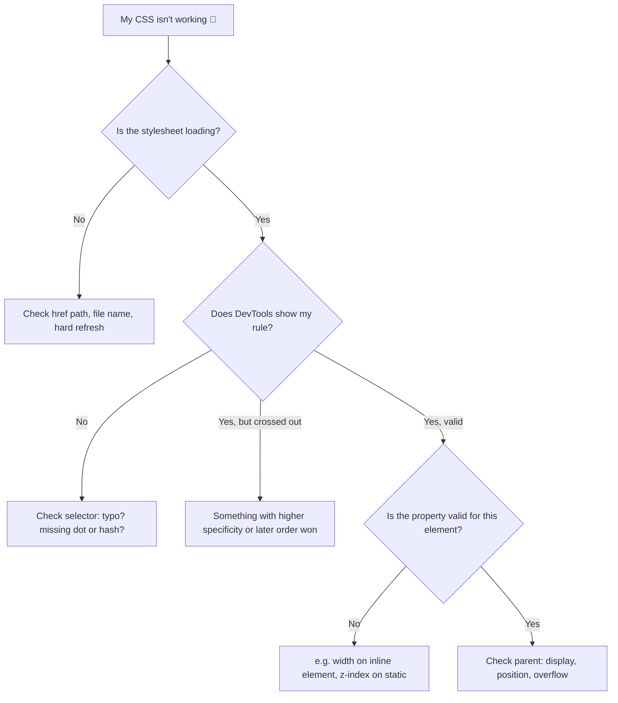

# 🗒️ CSS Cheat Sheet: The "I Forgot Again" Quick Reference


> No explanations here, just the stuff I'll need when my brain goes blank. For the *why*, click through to each topic file. 🧠➡️📄
>
> 📚 Cross-checked against freeCodeCamp's Basic CSS review (v9) on 2026-10-20.

⬅️ Previous: [animations.md](./animations.md) | ➡️ Next: [final-review.md](./final-review.md)

---

## 📍 Jump To

[Syntax](#-syntax-recap) · [Selectors](#-selectors) · [Pseudo](#-pseudo-classes--pseudo-elements) · [Specificity](#-specificity) · [Box model](#-box-model) · [Backgrounds](#-backgrounds--gradients) · [Colors & type](#-colors--typography) · [Lists & links](#-lists--links) · [Units](#-units) · [Flexbox](#-flexbox) · [Grid](#-grid) · [Position](#-position) · [Responsive](#-responsive) · [Transform & filter](#-transform--filter) · [Animation](#-animation) · [Starter reset](#-starter-reset) · [Debugging](#-debugging-flow) · [Next steps](#-next-step-kit-bridging-to-javascript)

---

## ✍️ Syntax Recap

```css
selector {
  property: value;
}
```

```html
<link rel="stylesheet" href="styles.css">
```

| Where CSS lives | Syntax | Use it? |
|---|---|---|
| Inline | `<p style="color: red;">` | Avoid (specificity 1-0-0-0) |
| Internal | `<style> ... </style>` in `<head>` | Small demos |
| External | `<link rel="stylesheet" href="styles.css">` | Default choice ✅ |

Browsers add **default styles** (margins, padding, font sizes) before yours. That's why resets exist → [Starter Reset](#-starter-reset).

---

## 🎯 Selectors

| Type | Syntax | Example |
|---|---|---|
| Universal | `*` | `* { }` |
| Element | `p` | `p { }` |
| Class | `.name` | `.card { }` |
| ID | `#name` | `#hero { }` |
| Group | `a, b` | `h1, h2 { }` |
| Descendant | `A B` | `nav a { }` |
| Child | `A > B` | `ul > li { }` |
| Adjacent sibling | `A + B` | `h2 + p { }` |
| General sibling | `A ~ B` | `h2 ~ p { }` |
| Attribute | `[attr="v"]` | `input[type="email"] { }` |
| Pseudo-class | `:hover` | `a:hover { }` |
| Pseudo-element | `::before` | `p::first-line { }` |
| Negation | `:not()` | `li:not(.done) { }` |
| Nth | `:nth-child(n)` | `tr:nth-child(even) { }` |

---

## 🎭 Pseudo-classes & Pseudo-elements

> Pseudo-**class** = a *state or position* (one colon `:`). Pseudo-**element** = a *part* of an element (two colons `::`).

| Group | Pseudo-classes |
|---|---|
| User action | `:hover` `:focus` `:active` `:focus-within` |
| Form state | `:enabled` `:disabled` `:checked` `:required` `:optional` `:valid` `:invalid` `:in-range` `:out-of-range` `:autofill` |
| Links / location | `:link` `:visited` `:any-link` `:target` |
| Position in tree | `:root` `:empty` `:first-child` `:last-child` `:only-child` `:nth-child(n)` `:nth-last-child(n)` |
| Position by type | `:first-of-type` `:last-of-type` `:only-of-type` `:nth-of-type(n)` |

| Functional | Example | Meaning |
|---|---|---|
| `:is()` | `p:is(.a, .b) { }` | Match any in the list |
| `:where()` | `:where(h1, h2) { }` | Same as `:is()` but specificity **0** |
| `:has()` | `article:has(h2) { }` | "Parent" selector |
| `:not()` | `p:not(.a) { }` | Everything except |

| `:nth-child()` formula | Picks |
|---|---|
| `odd` / `even` | 1st, 3rd… / 2nd, 4th… |
| `3` | Only the 3rd |
| `3n` | Every 3rd |
| `n+3` | 3rd and onward |

| Pseudo-element | Use |
|---|---|
| `::before` / `::after` | Insert cosmetic content (needs `content: ""`) |
| `::first-letter` | Drop caps |
| `::first-line` | Style the first line |
| `::marker` | Bullet / number of a list item |

```css
.tag::before { content: "🔥 "; }
```

---

## ⚔️ Specificity

```
inline  >  #id  >  .class / [attr] / :pseudo-class  >  element / ::pseudo-element
1-0-0-0    0-1-0-0          0-0-1-0                       0-0-0-1
```

Universal `*` = `0-0-0-0` (weakest of all).

Tie? **Last rule wins.** `!important` ☢️ beats it all (avoid).

| Cascade decides by | Order |
|---|---|
| 1 | Importance (`!important`) |
| 2 | Specificity |
| 3 | Source order (later wins) |

- `:is()`, `:not()`, `:has()` take the specificity of their **most specific** argument. `:where()` is always `0`.
- **Inheritance:** `color`, `font-*`, `line-height`, `text-align` pass down to children. `margin`, `padding`, `border`, `background`, `width` do **not**.

---

## 📦 Box Model

```
margin → border → padding → content
```

```css
*, *::before, *::after { box-sizing: border-box; }
```

| Shorthand | Order |
|---|---|
| `margin: 10px` | all sides |
| `margin: 10px 20px` | vertical, horizontal |
| `margin: 10px 20px 30px` | top, horizontal, bottom |
| `margin: 10px 20px 30px 40px` | top, right, bottom, left 🕐 |

| Need | Code |
|---|---|
| Center a block | `margin: 0 auto;` (set a `max-width`) |
| Rounded corners | `border-radius: 12px;` |
| Circle | `border-radius: 50%;` on a square |
| Shadow | `box-shadow: 0 4px 12px rgba(0,0,0,.2);` |
| Hide scrollbars unless needed | `overflow: auto;` |
| Truncate with "..." | `white-space: nowrap; overflow: hidden; text-overflow: ellipsis;` |

| `display` | Behavior |
|---|---|
| `block` | New line, full width |
| `inline` | Flows with text, ignores width/height |
| `inline-block` | Flows with text, respects width/height |
| `none` | Removed from layout |

| | Where | Background shows? |
|---|---|---|
| `padding` | Inside the border (content ↔ border) | ✅ |
| `margin` | Outside the border (between elements) | ❌ |

`padding` uses the same 1 to 4 value shorthand as `margin`.

**Margin collapse:** vertical margins of neighbouring blocks merge into the **larger** one (not the sum). Horizontal margins never collapse.

| `box-sizing` | `width` includes |
|---|---|
| `content-box` (default) | Content only (padding and border are added on top) |
| `border-box` | Content + padding + border (never margin) |

| Sizing | Notes |
|---|---|
| `width` / `height` | Default `auto` (browser decides) |
| `min-width` / `min-height` | Never smaller than this |
| `max-width` / `max-height` | Never bigger than this |

| Border | Code |
|---|---|
| Shorthand | `border: 1px solid #000;` (width style color) |
| One side | `border-top` / `-right` / `-bottom` / `-left` |
| Styles | `solid` `dashed` `dotted` `double` |

```css
/* box-shadow: x  y  blur  spread  color */
box-shadow: 10px 10px 20px 0 rgba(0,0,0,.5);
box-shadow: inset 0 0 8px #000;                 /* inside the box */
box-shadow: 0 2px 4px #0003, 0 8px 16px #0003;  /* several, comma-separated */
```

| `overflow` | Result |
|---|---|
| `visible` | Default, spills out |
| `hidden` | Clipped |
| `scroll` | Always shows scrollbars |
| `auto` | Scrollbars only if needed |

`overflow-x` / `overflow-y` set one axis. `overflow: hidden auto;` = x then y.

---

## 🎨 Backgrounds & Gradients

| Property | Example |
|---|---|
| `background-color` | `#222` (add one as a fallback for images) |
| `background-image` | `url("img.jpg")` |
| `background-size` | `cover` (fill, may crop) / `contain` (fit, may leave gaps) |
| `background-repeat` | `no-repeat` (default is `repeat`) |
| `background-position` | `center top` |
| `background-attachment` | `fixed` (stays put) / `scroll` (default) |
| Shorthand | `background: url("img.jpg") center top / cover no-repeat;` |

```css
background: linear-gradient(to right, red, blue);
background: linear-gradient(45deg, red, #3f1, rgb(100 100 255 / 50%));
background: radial-gradient(circle, red, blue);
```

Direction: `to top` / `to right` / `to bottom right` or an angle like `45deg`. Add as many color stops as you want.

---

## 🌈 Colors & Typography

| Format | Example |
|---|---|
| Hex | `#dc143c` |
| RGB | `rgb(220 20 60)` |
| RGB + alpha | `rgb(220 20 60 / 50%)` |
| HSL | `hsl(348 83% 47%)` |
| Named | `crimson` |
| Hex shorthand | `#2fb` = `#22ffbb` (only when each pair repeats) |
| Legacy alpha | `rgba(220, 20, 60, 0.5)` / `hsla(348, 83%, 47%, 0.5)` |

```css
:root { --brand: #b3122f; }
a { color: var(--brand); }
```

| Property | Typical value |
|---|---|
| `font-family` | `"Name", system-ui, sans-serif` |
| `font-size` | `1rem` |
| `font-weight` | `400` / `600` / `700` |
| `font-style` | `italic` / `oblique` |
| `line-height` | `1.5` (unitless) |
| `letter-spacing` | `0.05em` |
| `text-align` | `left` / `center` / `right` |
| `text-transform` | `uppercase` |
| `text-decoration` | `none` |
| Readable line length | `max-width: 65ch;` |
| Fluid heading | `font-size: clamp(1.75rem, 5vw, 3.5rem);` |

**Contrast target:** 4.5 : 1 for normal text, 3 : 1 for large text.

Always end `font-family` with a **generic** family: `serif` `sans-serif` `monospace` `cursive` `fantasy`.
Web-safe sans-serif: Arial, Verdana, Trebuchet MS. Stick to 2 or 3 fonts max.

| Term | Meaning | CSS |
|---|---|---|
| Typeface | The design family (e.g. Helvetica) | `font-family` |
| Font | One variant: size, weight, style, width | |
| Serif / Sans-serif | With / without small strokes on letters | |
| Kerning | Space between **specific pairs** (A V) | |
| Tracking | Space between **all** letters | `letter-spacing` |
| Leading | Space between lines | `line-height` |
| Baseline · x-height · cap height | Line letters sit on · lowercase height · uppercase height | |
| Ascender · descender | Part above x-height (`h`, `b`) · part below baseline (`y`, `g`) | |

---

## 🔗 Lists & Links

| List property | Values |
|---|---|
| `list-style-type` | `disc` `circle` `square` `decimal` `none` |
| `list-style-position` | `outside` (default) / `inside` |
| `list-style-image` | `url("bullet.svg")` |
| Remove bullets | `ul { list-style: none; padding: 0; }` |
| Space items | `li { margin-bottom: 10px; }` or `line-height` |

```css
a:link    { color: navy; }      /* unvisited */
a:visited { color: purple; }
a:hover,
a:focus   { text-decoration: underline; }
a:focus   { outline: 2px solid orange; }  /* keep a visible focus ring! */
a:active  { color: crimson; }
```

Order matters: **link → visited → hover → active** (LVHA). Give `:focus` the same style as `:hover` so keyboard users get it too.

---

## 📏 Units

| Unit | Meaning | Use |
|---|---|---|
| `px` | Pixels | Borders, shadows |
| `rem` | Root font size (16px default) | Text, spacing ✅ |
| `em` | Element/parent font size | Component spacing |
| `%` | Percent of parent | Widths |
| `vw` / `vh` / `dvh` | % of viewport | Full-screen sections |
| `ch` | Width of "0" | Line lengths |
| `fr` | Fraction of free space | Grid |

| Absolute unit | Equals |
|---|---|
| `in` | 96px |
| `pc` (pica) | 1/6 in (16px) |
| `pt` (point) | 1/72 in |
| `cm` | about 37.8px |
| `mm` | 1/10 cm |
| `q` (quarter-mm) | 1/40 cm |

```css
width: calc(100% - 40px);   /* spaces around + and - are required */
```

---

## 📏 Flexbox

```css
.row {
  display: flex;
  flex-direction: row;            /* or column */
  justify-content: space-between; /* MAIN axis */
  align-items: center;            /* CROSS axis */
  flex-wrap: wrap;
  gap: 1rem;
}
.item { flex: 1; }                /* grow to share space */
```

| `justify-content` | Result |
|---|---|
| `flex-start` | `[1][2][3]····` |
| `center` | `··[1][2][3]··` |
| `flex-end` | `····[1][2][3]` |
| `space-between` | `[1]··[2]··[3]` |
| `space-around` | `·[1]··[2]··[3]·` |
| `space-evenly` | `·[1]·[2]·[3]·` |

| `align-items` | Result |
|---|---|
| `stretch` | Default, fills the cross axis |
| `flex-start` | Start of the cross axis |
| `center` | Middle of the cross axis |
| `flex-end` | End of the cross axis |

| Property | Values |
|---|---|
| `flex-direction` | `row` `row-reverse` `column` `column-reverse` |
| `flex-wrap` | `nowrap` (default) `wrap` `wrap-reverse` |
| `flex-flow` | Shorthand: `row wrap` |

> 🔁 `flex-direction: column` swaps what `justify-content` and `align-items` do.

---

## 🔲 Grid

```css
.grid {
  display: grid;
  grid-template-columns: repeat(3, 1fr);
  gap: 1rem;
}
```

| Goal | Code |
|---|---|
| Equal columns | `repeat(3, 1fr)` |
| Sidebar + content | `250px 1fr` |
| Responsive, no media query | `repeat(auto-fit, minmax(220px, 1fr))` |
| Span 2 columns | `grid-column: span 2;` |
| Named layout | `grid-template-areas: "header header" "side main";` |
| Center anything | `display: grid; place-items: center;` |

---

## 📌 Position

| Value | Rule of thumb |
|---|---|
| `static` | Default |
| `relative` | Nudge from normal spot; also the anchor for absolute children |
| `absolute` | Placed against nearest positioned ancestor |
| `fixed` | Stuck to the viewport |
| `sticky` | Sticks after scrolling to `top: 0` etc. |

```css
.overlay { position: fixed; inset: 0; }   /* covers the whole screen */
```

`z-index` only works on positioned elements (and flex/grid items).

---

## 📱 Responsive

```html
<meta name="viewport" content="width=device-width, initial-scale=1.0">
```

```css
img { max-width: 100%; height: auto; display: block; }

/* mobile-first */
@media (min-width: 768px)  { /* tablet+ */ }
@media (min-width: 1100px) { /* desktop+ */ }

@media (prefers-color-scheme: dark)  { }
@media (prefers-reduced-motion: reduce) { }
```

---

## 🔄 Transform & Filter

| `transform` | Does |
|---|---|
| `translate(20px, 10px)` / `translateX()` / `translateY()` | Move |
| `scale(1.2)` | Resize |
| `rotate(15deg)` | Rotate |
| `skew(10deg, 5deg)` | Slant |

```css
transform: translateX(20px) rotate(15deg);   /* chain with spaces, order matters */
filter: grayscale(100%) blur(3px);
```

| `filter` | Example |
|---|---|
| `blur()` | `blur(3px)` |
| `brightness()` | `brightness(130%)` (0% = black) |
| `contrast()` | `contrast(150%)` (0% = grey) |
| `grayscale()` | `grayscale(100%)` |
| `sepia()` | `sepia(100%)` |
| `hue-rotate()` | `hue-rotate(90deg)` |

> ♿ To hide content, use `display: none` or `visibility: hidden`. Don't just slide it off-screen with `transform`, screen readers and keyboards will still find it.

---

## ✨ Animation

```css
.btn { transition: transform 0.25s ease, background 0.25s ease; }
.btn:hover { transform: translateY(-4px); }

@keyframes spin { to { transform: rotate(360deg); } }
.spinner { animation: spin 0.8s linear infinite; }
```

| Safe to animate | Avoid animating |
|---|---|
| `transform`, `opacity` 🟢 | `width`, `height`, `margin`, `top`, `left` 🔴 |

---

## 🧼 Starter Reset

Copy-paste this at the top of a new stylesheet:

```css
*, *::before, *::after { box-sizing: border-box; }

body {
  margin: 0;
  font-family: system-ui, sans-serif;
  line-height: 1.5;
}

img, video { max-width: 100%; height: auto; display: block; }

button, input, select, textarea { font: inherit; }
```

---

## 🕵️ Debugging Flow



Quick checks:

- [ ] Typo in a property name or missing `;`
- [ ] Wrong selector (`.card` vs `card`)
- [ ] Rule overridden (look for strikethroughs in DevTools)
- [ ] Browser cache (`Ctrl/Cmd + Shift + R`)
- [ ] Right element? Hover over it in the Elements panel

---

## 🚀 Next-Step Kit: Bridging to JavaScript

CSS makes things *look* right. JavaScript makes them *do* things. The bridge between the two is mostly **changing classes**.

| CSS side | JavaScript side |
|---|---|
| `.hidden { display: none; }` | `el.classList.toggle("hidden")` |
| `.dark { background: #111; }` | `document.body.classList.add("dark")` |
| `:hover` styles | `el.addEventListener("mouseenter", ...)` |
| `var(--accent)` | `el.style.setProperty("--accent", "crimson")` |

### First mini-project ideas

| Project | CSS skills used | JS skills you'd learn |
|---|---|---|
| 🌙 Dark mode toggle | Variables, `.dark` class | Selecting elements, click events, `classList` |
| 📂 Accordion / FAQ | Transitions, `max-height` | Event listeners, toggling |
| 🍔 Mobile menu | Flexbox, media queries | Toggle a class on click |
| 🧮 Tip calculator | Grid, forms styling | Reading inputs, math, updating text |

### Before starting JavaScript, make sure:

- [ ] I'm comfortable linking a script with `<script src="script.js" defer></script>`
- [ ] I can find elements in DevTools and edit styles live
- [ ] I can name the three layers: HTML (structure), CSS (style), JS (behavior)

⬅️ Previous: [animations.md](./animations.md) | ➡️ Next: [final-review.md](./final-review.md)
