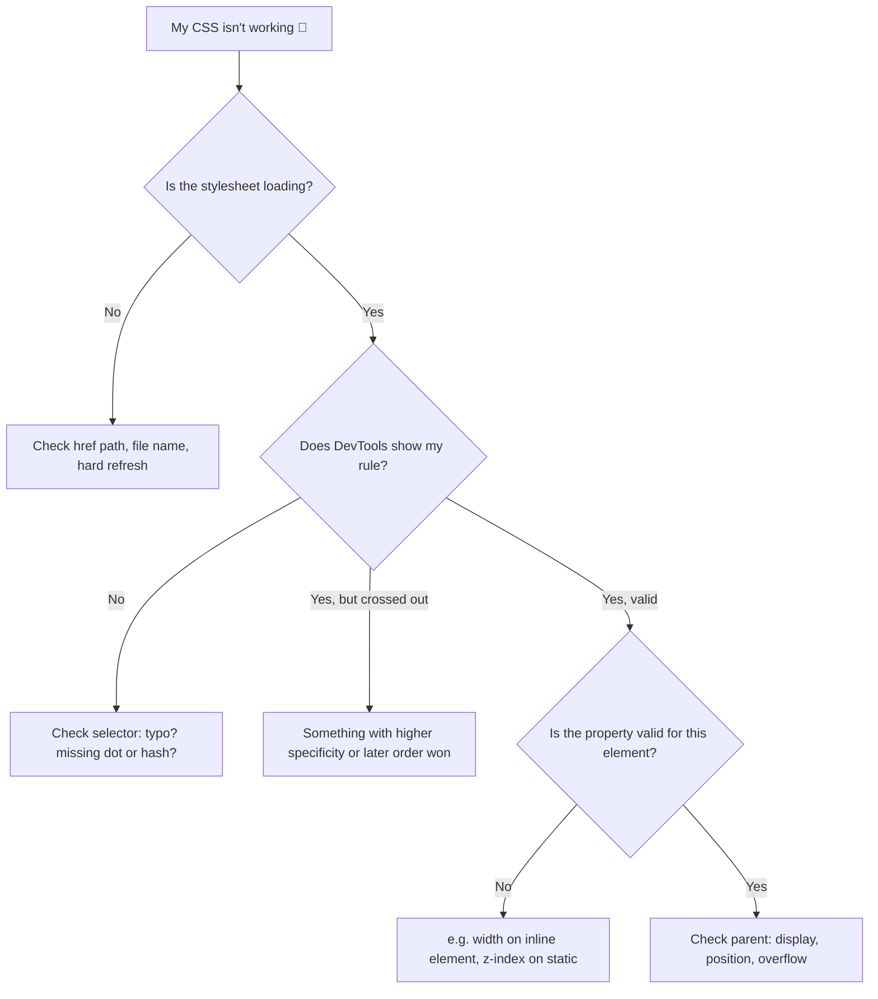

# 🗒️ CSS Cheat Sheet: The "I Forgot Again" Quick Reference


> No explanations here, just the stuff I'll need when my brain goes blank. For the *why*, click through to each topic file. 🧠➡️📄

⬅️ Previous: [animations.md](./animations.md) | ➡️ Next: [final-review.md](./final-review.md)

---

## 📍 Jump To

[Syntax](#-syntax-recap) · [Selectors](#-selectors) · [Specificity](#-specificity) · [Box model](#-box-model) · [Colors & type](#-colors--typography) · [Units](#-units) · [Flexbox](#-flexbox) · [Grid](#-grid) · [Position](#-position) · [Responsive](#-responsive) · [Animation](#-animation) · [Starter reset](#-starter-reset) · [Debugging](#-debugging-flow) · [Next steps](#-next-step-kit-bridging-to-javascript)

---

## ✍️ Syntax Recap

```css
selector {
  property: value;
}
```

```html
<link rel="stylesheet" href="styles.css">
```

---

## 🎯 Selectors

| Type | Syntax | Example |
|---|---|---|
| Element | `p` | `p { }` |
| Class | `.name` | `.card { }` |
| ID | `#name` | `#hero { }` |
| Group | `a, b` | `h1, h2 { }` |
| Descendant | `A B` | `nav a { }` |
| Child | `A > B` | `ul > li { }` |
| Adjacent sibling | `A + B` | `h2 + p { }` |
| General sibling | `A ~ B` | `h2 ~ p { }` |
| Attribute | `[attr="v"]` | `input[type="email"] { }` |
| Pseudo-class | `:hover` | `a:hover { }` |
| Pseudo-element | `::before` | `p::first-line { }` |
| Negation | `:not()` | `li:not(.done) { }` |
| Nth | `:nth-child(n)` | `tr:nth-child(even) { }` |

---

## ⚔️ Specificity

```
inline  >  #id  >  .class / [attr] / :pseudo-class  >  element / ::pseudo-element
1-0-0-0    0-1-0-0          0-0-1-0                       0-0-0-1
```

Tie? **Last rule wins.** `!important` ☢️ beats it all (avoid).

---

## 📦 Box Model

```
margin → border → padding → content
```

```css
*, *::before, *::after { box-sizing: border-box; }
```

| Shorthand | Order |
|---|---|
| `margin: 10px` | all sides |
| `margin: 10px 20px` | vertical, horizontal |
| `margin: 10px 20px 30px` | top, horizontal, bottom |
| `margin: 10px 20px 30px 40px` | top, right, bottom, left 🕐 |

| Need | Code |
|---|---|
| Center a block | `margin: 0 auto;` (set a `max-width`) |
| Rounded corners | `border-radius: 12px;` |
| Circle | `border-radius: 50%;` on a square |
| Shadow | `box-shadow: 0 4px 12px rgba(0,0,0,.2);` |
| Hide scrollbars unless needed | `overflow: auto;` |
| Truncate with "..." | `white-space: nowrap; overflow: hidden; text-overflow: ellipsis;` |

| `display` | Behavior |
|---|---|
| `block` | New line, full width |
| `inline` | Flows with text, ignores width/height |
| `inline-block` | Flows with text, respects width/height |
| `none` | Removed from layout |

---

## 🌈 Colors & Typography

| Format | Example |
|---|---|
| Hex | `#dc143c` |
| RGB | `rgb(220 20 60)` |
| RGB + alpha | `rgb(220 20 60 / 50%)` |
| HSL | `hsl(348 83% 47%)` |

```css
:root { --brand: #b3122f; }
a { color: var(--brand); }
```

| Property | Typical value |
|---|---|
| `font-family` | `"Name", system-ui, sans-serif` |
| `font-size` | `1rem` |
| `font-weight` | `400` / `600` / `700` |
| `line-height` | `1.5` (unitless) |
| `letter-spacing` | `0.05em` |
| `text-align` | `left` / `center` / `right` |
| `text-transform` | `uppercase` |
| `text-decoration` | `none` |
| Readable line length | `max-width: 65ch;` |
| Fluid heading | `font-size: clamp(1.75rem, 5vw, 3.5rem);` |

**Contrast target:** 4.5 : 1 for normal text, 3 : 1 for large text.

---

## 📏 Units

| Unit | Meaning | Use |
|---|---|---|
| `px` | Pixels | Borders, shadows |
| `rem` | Root font size (16px default) | Text, spacing ✅ |
| `em` | Element/parent font size | Component spacing |
| `%` | Percent of parent | Widths |
| `vw` / `vh` / `dvh` | % of viewport | Full-screen sections |
| `ch` | Width of "0" | Line lengths |
| `fr` | Fraction of free space | Grid |

---

## 📏 Flexbox

```css
.row {
  display: flex;
  flex-direction: row;            /* or column */
  justify-content: space-between; /* MAIN axis */
  align-items: center;            /* CROSS axis */
  flex-wrap: wrap;
  gap: 1rem;
}
.item { flex: 1; }                /* grow to share space */
```

| `justify-content` | Result |
|---|---|
| `flex-start` | `[1][2][3]····` |
| `center` | `··[1][2][3]··` |
| `flex-end` | `····[1][2][3]` |
| `space-between` | `[1]··[2]··[3]` |
| `space-evenly` | `·[1]·[2]·[3]·` |

> 🔁 `flex-direction: column` swaps what `justify-content` and `align-items` do.

---

## 🔲 Grid

```css
.grid {
  display: grid;
  grid-template-columns: repeat(3, 1fr);
  gap: 1rem;
}
```

| Goal | Code |
|---|---|
| Equal columns | `repeat(3, 1fr)` |
| Sidebar + content | `250px 1fr` |
| Responsive, no media query | `repeat(auto-fit, minmax(220px, 1fr))` |
| Span 2 columns | `grid-column: span 2;` |
| Named layout | `grid-template-areas: "header header" "side main";` |
| Center anything | `display: grid; place-items: center;` |

---

## 📌 Position

| Value | Rule of thumb |
|---|---|
| `static` | Default |
| `relative` | Nudge from normal spot; also the anchor for absolute children |
| `absolute` | Placed against nearest positioned ancestor |
| `fixed` | Stuck to the viewport |
| `sticky` | Sticks after scrolling to `top: 0` etc. |

```css
.overlay { position: fixed; inset: 0; }   /* covers the whole screen */
```

`z-index` only works on positioned elements (and flex/grid items).

---

## 📱 Responsive

```html
<meta name="viewport" content="width=device-width, initial-scale=1.0">
```

```css
img { max-width: 100%; height: auto; display: block; }

/* mobile-first */
@media (min-width: 768px)  { /* tablet+ */ }
@media (min-width: 1100px) { /* desktop+ */ }

@media (prefers-color-scheme: dark)  { }
@media (prefers-reduced-motion: reduce) { }
```

---

## ✨ Animation

```css
.btn { transition: transform 0.25s ease, background 0.25s ease; }
.btn:hover { transform: translateY(-4px); }

@keyframes spin { to { transform: rotate(360deg); } }
.spinner { animation: spin 0.8s linear infinite; }
```

| Safe to animate | Avoid animating |
|---|---|
| `transform`, `opacity` 🟢 | `width`, `height`, `margin`, `top`, `left` 🔴 |

---

## 🧼 Starter Reset

Copy-paste this at the top of a new stylesheet:

```css
*, *::before, *::after { box-sizing: border-box; }

body {
  margin: 0;
  font-family: system-ui, sans-serif;
  line-height: 1.5;
}

img, video { max-width: 100%; height: auto; display: block; }

button, input, select, textarea { font: inherit; }
```

---

## 🕵️ Debugging Flow



Quick checks:

- [ ] Typo in a property name or missing `;`
- [ ] Wrong selector (`.card` vs `card`)
- [ ] Rule overridden (look for strikethroughs in DevTools)
- [ ] Browser cache (`Ctrl/Cmd + Shift + R`)
- [ ] Right element? Hover over it in the Elements panel

---

## 🚀 Next-Step Kit: Bridging to JavaScript

CSS makes things *look* right. JavaScript makes them *do* things. The bridge between the two is mostly **changing classes**.

| CSS side | JavaScript side |
|---|---|
| `.hidden { display: none; }` | `el.classList.toggle("hidden")` |
| `.dark { background: #111; }` | `document.body.classList.add("dark")` |
| `:hover` styles | `el.addEventListener("mouseenter", ...)` |
| `var(--accent)` | `el.style.setProperty("--accent", "crimson")` |

### First mini-project ideas

| Project | CSS skills used | JS skills you'd learn |
|---|---|---|
| 🌙 Dark mode toggle | Variables, `.dark` class | Selecting elements, click events, `classList` |
| 📂 Accordion / FAQ | Transitions, `max-height` | Event listeners, toggling |
| 🍔 Mobile menu | Flexbox, media queries | Toggle a class on click |
| 🧮 Tip calculator | Grid, forms styling | Reading inputs, math, updating text |

### Before starting JavaScript, make sure:

- [ ] I'm comfortable linking a script with `<script src="script.js" defer></script>`
- [ ] I can find elements in DevTools and edit styles live
- [ ] I can name the three layers: HTML (structure), CSS (style), JS (behavior)

⬅️ Previous: [animations.md](./animations.md) | ➡️ Next: [final-review.md](./final-review.md)
