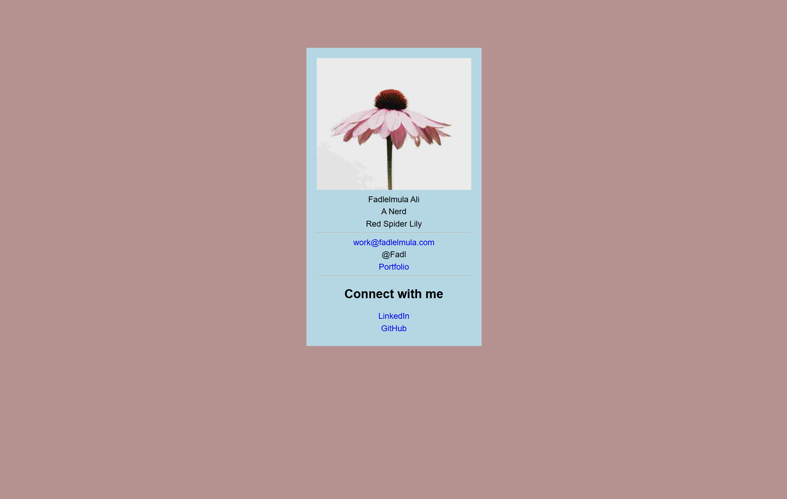

# 💼 Business Card

> **Mark I** of my digital identity: a tiny blue card on a rosy-brown background, built at a freeCodeCamp Lab.
> Every Stark suit started with a name plate. Mine says "A Nerd." 🦾

---

## 📸 Preview

---

## 🎯 What This Project Is

A single centered **digital business card**: profile picture, name, title, company, contact details, and links to my social profiles.
The goal was to practice **styling one component with CSS**: centering it, sizing it, coloring it, and keeping the image inside the box.

---

## 🗂️ Folder Map

| File | What it does |
|------|--------------|
| 📄 `index.html` | The card's structure: image, name, title, company, contact, links |
| 🎨 `styles.css` | Page background, card box, text alignment, link styling |
| 🖼️ `screenshot.png` | What the finished card looks like |
| 📘 `README.md` | You are here 👋 |

---

## 🧱 HTML Skills Used

| Element | Where | Why |
|---------|-------|-----|
| `
` | wraps everything | the card container I can style as one box |
| `` | profile picture | an image with a text alternative |
| `
` with classes | name, designation, company | each line gets its own hook for styling |
| `
` | between the sections | visual dividers |
| `<h2>` | "Connect with me" | a heading for the social section |
| `<a href>` | Portfolio, Twitter, LinkedIn, GitHub | links |

---

## 🎨 CSS Skills Used

| Concept | Example in this project |
|---------|-------------------------|
| Page background | `body { background: rosybrown; }` |
| Font stack | `font-family: Arial, sans-serif` |
| Fixed-width box | `.business-card { width: 300px; padding: 20px; }` |
| Centering a block | `margin-left: auto; margin-right: auto;` |
| Pushing it down | `margin-top: 100px` |
| Centering text | `text-align: center` on the card (children inherit it) |
| Responsive image | `.profile-image { max-width: 100%; }` keeps it inside the card |
| Element selectors | `p { margin-top: 5px; margin-bottom: 5px; }` |
| Removing underlines | `a { text-decoration: none; }` |

---

## 🧠 What I Learned

- `text-align: center` on the **parent** centers the text of every child, because the property is inherited.
- `max-width: 100%` is the easy way to stop an image from overflowing its container.
- `margin: auto` on the left and right is how you center a block that has a set width.
- An element selector like `p` styles **every** paragraph on the page, including the ones inside links.
- A link without `https://` is a **relative** URL: the browser looks for a file with that name next to my HTML file.
- `box-sizing: border-box` makes `width` include the padding, so sizes add up the way you expect.
- Browsers use headings to understand a page's outline, so the main title should be the `<h1>`, and I can restyle it to look however I want.

---

## 🐛 Gremlins Squashed in Mark II

- [x] 🔗 **Broken links:** LinkedIn now has `https://` so it points to the real site instead of a file inside my project
- [ ] 🐦 **Twitter/X link:** removed (commented out in the HTML) until I have the real URL
- [x] 🔠 **File names:** `index.html` (lowercase) and `styles.css`, matching the `<link>`
- [x] 📱 Added the viewport meta tag
- [x] 📐 Added `box-sizing: border-box` and swapped `width: 300px` for `max-width: 340px`, so the card shrinks on small screens
- [x] 📧 The email is now a `mailto:` link
- [x] 🔤 The name is an `<h1>` (restyled to look the same) and the links no longer have `
` inside them
- [x] ✨ Added `a:hover` and `a:focus` underlines

---

## ▶️ How to Run It

1. Download or clone the repo
2. Open `index.html` in any browser
3. That's it. No build step, no install. ✨

> 🌐 The profile image loads from freeCodeCamp's CDN, so you need an internet connection to see it.

---

## 🔗 Links

- ⬅️ Back to [CSS examples](../README.md)
- 🏕️ Built following the [freeCodeCamp](https://www.freecodecamp.org) Responsive Web Design curriculum

---

## 🦾 Next Suit

Mark II works and the links finally go somewhere. Next up: add the Twitter/X link, then rebuild the layout with Flexbox for Mark III. 🚀
