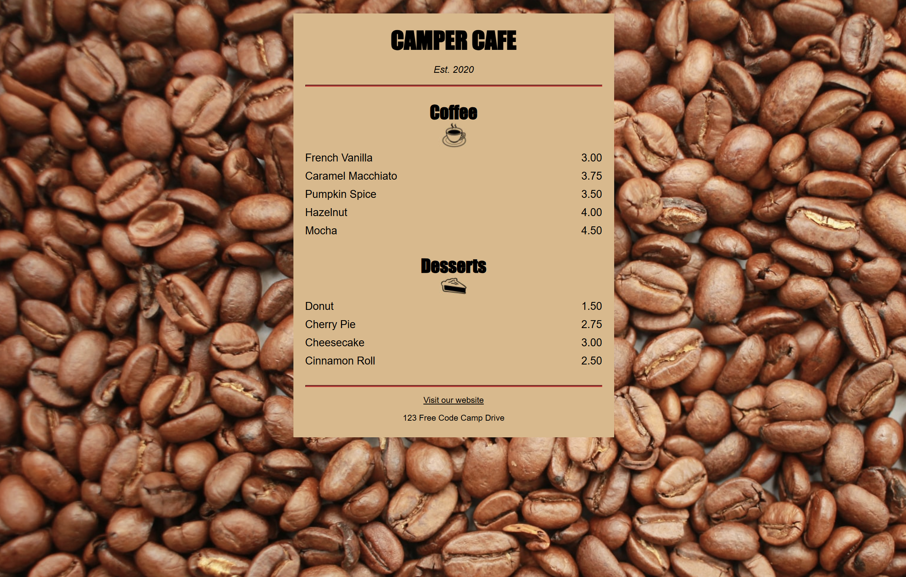

# ☕ Camper Cafe: Coffee Menu

> **Mark I** of my CSS suit: a one-page cafe menu built from scratch at a freeCodeCamp workshop.
> Brown, boxy, and fully functional. Tony Stark's first suit was built in a cave out of scraps. Mine was built in a `
`. 🔧

---

## 📸 Preview

*(The menu in all its burlywood glory.)*

---

## 🎯 What This Project Is

A centered, mobile-friendly coffee and dessert menu for the fictional **Camper Cafe (Est. 2020)**.
The whole point: practice **styling a page with CSS** (box model, text alignment, backgrounds, `inline-block` layout, link states) on top of clean semantic HTML.

---

## 🗂️ Folder Map

| File | What it does |
|------|--------------|
| 📄 `index.html` | The structure: heading, two menu sections, footer with address and link |
| 🎨 `styles.css` | All the styling: background, menu card, item rows, footer, link states |
| 🖼️ `screenshot.png` | What the finished page looks like |
| 📘 `README.md` | You are here 👋 |

---

## 🧱 HTML Skills Used

| Element | Where | Why |
|---------|-------|-----|
| `<main>` | wraps the menu content | tells browsers and screen readers "this is the main stuff" |
| `<section>` | Coffee, Desserts | groups related content, each with its own `<h2>` |
| `<article class="item">` | every menu row | one self-contained item (name + price) |
| `
` | under the title, above the footer | visual dividers |
| `` | coffee and pie icons | images with text alternatives |
| `<footer>` + `<address>` | bottom of page | contact info, semantically correct |
| `<a target="_blank">` | "Visit our website" | opens the link in a new tab |

---

## 🎨 CSS Skills Used

| Concept | Example in this project |
|---------|-------------------------|
| Background image | `body { background-image: url(...) }` |
| Centering a block | `margin-left: auto; margin-right: auto;` on `.menu` |
| Responsive width | `width: 80%` + `max-width: 500px` |
| Grouped selectors | `h1, h2, p { text-align: center; }` |
| Class selectors | `.flavor`, `.dessert`, `.price`, `.established` |
| Inline-block layout | `.item p { display: inline-block; }` then 75% / 25% widths |
| Overriding styles | `.flavor` is `text-align: left` and wins over the generic `p` rule |
| Negative margin | `margin-top: -25px` on images to tuck them under headings |
| Link states | `a`, `a:visited`, `a:hover`, `a:active` in that order (LVHA) |

---

## 🧠 What I Learned

- A **class selector beats an element selector**, which is why `.flavor` can override `p`.
- Two `inline-block` elements at **75% + 25%** only fit on one line if there is **no whitespace** between them in the HTML. That is why the `
` tags touch.
- `auto` left and right margins are the classic way to center a block with a set width.
- Link pseudo-classes have an order that matters (**L**o**V**e **HA**te).

---

## 🐛 Gremlins / Mark II Backlog

Honest list of things that work now but could be better:

- [ ] Add `box-sizing: border-box` so the menu's padding doesn't make it wider than `max-width`
- [ ] Swap the 75% / 25% `inline-block` trick for **Flexbox** (`display: flex; justify-content: space-between`)
- [ ] Add a `background-color` fallback on `body` in case the beans image doesn't load
- [ ] Change the `Impact, serif` fallback to `Impact, sans-serif`
- [ ] Merge the two `h1, h2` rules into one
- [ ] Add `rel="noopener noreferrer"` to the `target="_blank"` link
- [ ] Check the `:hover` brown against burlywood for color contrast (it's a bit low for small text)
- [ ] Use `rem` instead of `px` for font sizes so text respects user settings
- [ ] Add a `$` to the prices

---

## ▶️ How to Run It

1. Download or clone the repo
2. Open `index.html` in any browser
3. That's it. No build step, no install. ✨

> 🌐 Images load from freeCodeCamp's CDN, so you need an internet connection to see them.

---

## 🔗 Links

- ⬅️ Back to [CSS examples](../README.md)
- 🏕️ Built following the [freeCodeCamp](https://www.freecodecamp.org) Responsive Web Design curriculum

---

## 🦾 Next Suit

Mark I works. Next up: rebuild this menu with Flexbox and fix the backlog above (Mark II), then keep iterating toward Mark 85. 🚀
