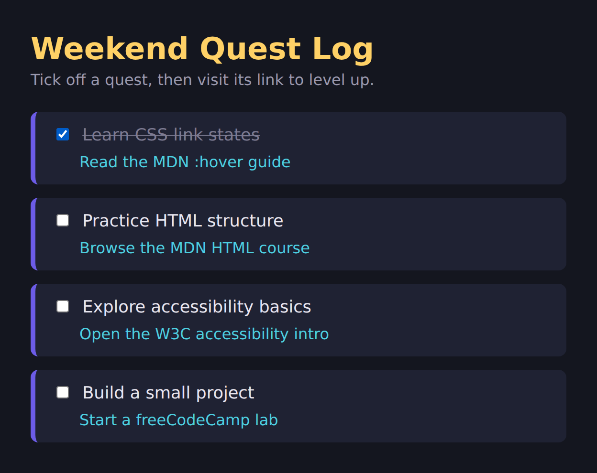

# ✅ Weekend Quest Log: To-Do List

> **Mark I** of my quest tracker: a dark-mode to-do list where ticking a box strikes the quest and every quest hides a link to level up.
> Tony Stark has JARVIS. I have four checkboxes and a purple stripe. 🦾

---

## 📸 Preview

*(First quest ticked to show the strike-through. With nothing ticked, every label is plain off-white.)*

---

## 🎯 What This Project Is

A **to-do list with a link under every task**. Tick a quest and its label gets crossed out, then click the link below it to go learn the thing.
The goal: practice **lists, checkboxes with labels, and link states (`:link`, `:visited`, `:hover`, `:focus`, `:active`)**, all with pure HTML and CSS. No JavaScript. 🧪

---

## 🗂️ Folder Map

| File | What it does |
|------|--------------|
| 📄 `index.html` | The structure: heading, tagline, four quests (checkbox + label + nested link list) |
| 🎨 `styles.css` | Dark theme, quest cards, checked-state strike-through, the five link states |
| 🖼️ `screenshot.png` | What the finished page looks like |
| 📘 `README.md` | You are here 👋 |

---

## 🧱 HTML Skills Used

| Element | Where | Why |
|---------|-------|-----|
| `<main>` | wraps the page content | the main stuff, for browsers and screen readers |
| `<ul class="todo-list">` | the quest list | one list holding all four quests |
| nested `<ul class="sub-item">` | inside each quest | a list inside a list item for the link |
| `<input type="checkbox" id="quest-1">` | every quest | the tickable box, each with a **unique** `id` |
| `<label for="quest-1">` | every quest | `for` matches the input's `id`, so clicking the text toggles the box |
| `<a target="_blank" rel="noopener noreferrer">` | every link | opens a new tab, safely |
| `<meta name="viewport">` | `<head>` | scales the page on phones |
| `<!-- comments -->` | everywhere | notes to future me |

---

## 🎨 CSS Skills Used

| Concept | Example in this project |
|---------|-------------------------|
| Centering with Flexbox | `body { display: flex; justify-content: center; }` |
| Fluid width with a cap | `main { width: 100%; max-width: 560px; }` |
| Removing bullets | `list-style: none; margin: 0; padding: 0;` |
| Child combinator | `.todo-list > li` styles only the four top-level items, not the nested ones |
| Attribute + pseudo-class | `input[type="checkbox"]:checked` |
| General sibling combinator | `... ~ label` targets the label **after** a checked box |
| Strike-through | `text-decoration: line-through` |
| Card look | `border-left`, `border-radius`, `padding`, `margin-bottom` |
| Link states in order | `a:link`, `a:visited`, `a:hover`, `a:focus`, `a:active` |
| Focus ring | `outline: 3px solid ...` plus `outline-offset: 3px` |
| Padding that doesn't add width | `box-sizing: border-box` on the body |

---

## 🧠 What I Learned

- `:checked` plus `~` lets pure CSS react to a checkbox. No JavaScript needed.
- A `<label>` with `for` and a matching `id` makes the text clickable, which also makes the box easier to hit.
- Using `>` (child combinator) stops the card style from leaking into the nested list.
- Link states fight over the same property, so **order matters**: later rules win when states overlap.
- `outline-offset` leaves a gap so the focus ring is easy to see.

---

## 🐛 Gremlins / Mark II Backlog

Honest list of what could be better:

- [ ] 🔤 **Contrast:** the crossed-out label is `#7d7b92` on `#1f2233`, which measures about **3.8 : 1**. Normal text should be **4.5 : 1** or more. `#9a98ad` (my tagline color) gets about 5.6 : 1.
- [ ] ⌨️ Swap `a:focus` for `a:focus-visible` so the gold ring shows for keyboard users but not on every mouse click
- [ ] 🎨 Add `accent-color: #6c5ce7` to the checkboxes so they match the purple stripe
- [ ] 📝 Fix two code comments: the checked-state comment mentions `+` but the code only uses `~`, and the "LoVe HAte" mnemonic covers four states while the code has five (focus sits between hover and active)
- [ ] 🔗 Double-check the MDN "HTML course" link: MDN reorganised its learning section, and the old `/docs/Learn/HTML` path may only work through a redirect
- [ ] 📱 Swap `100vh` for `100dvh` so mobile browser toolbars don't cause extra scrolling
- [ ] 💾 **Progress isn't saved:** refresh the page and every box is unticked again. Saving it needs JavaScript (`localStorage`), which is the next suit.

---

## ▶️ How to Run It

1. Download or clone the repo
2. Open `index.html` in any browser
3. Tick a quest. Hover, Tab to, and click its link. That's it. No build step, no install. ✨

---

## 🔗 Links

- ⬅️ Back to [CSS examples](../README.md)
- 🏕️ Built following the [freeCodeCamp](https://www.freecodecamp.org) Responsive Web Design curriculum

---

## 🦾 Next Suit

Mark I works (the strike-through and all five link states do their job). Next up: fix the backlog above, then add **JavaScript** so my progress survives a refresh. That's Mark II. 🚀
