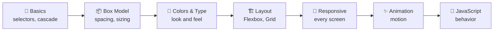

# 🏁 CSS Final Review: Suit Check Before Launch


> Tony tests every suit before he flies it. This is the test flight for the CSS folder. 🛫 Nothing here is ticked off until I've actually done it.

⬅️ Previous: [cheat-sheet.md](./cheat-sheet.md) | 🏠 [CSS README](./README.md)

---

## 📍 Table of Contents

1. [The big picture](#-the-big-picture)
2. [Topic recap](#-topic-recap)
3. [Self-test questions](#-self-test-questions)
4. [Skills checklist](#-skills-checklist)
5. [Mark progress tracker](#-mark-progress-tracker)
6. [Gremlins and backlog](#-gremlins--mark-ii-backlog)
7. [Reflection](#-reflection-template)
8. [What's next](#-whats-next)

---

## 🗺️ The Big Picture



---

## 🧠 Topic Recap

| Topic | One-sentence summary | Link |
|---|---|---|
| 🧱 **Basics** | CSS targets elements with selectors, and conflicts are settled by specificity then source order | [basics.md](./basics.md) |
| 📦 **Box model** | Every element is content + padding + border + margin, and `border-box` makes sizing predictable | [box-model.md](./box-model.md) |
| 🌈 **Colors & type** | Colors come in hex/RGB/HSL, `rem` scales text well, variables keep a palette in one place | [colors-and-typography.md](./colors-and-typography.md) |
| 🏗️ **Layout** | Flexbox for one dimension, Grid for two, `position` for overlaps and sticking | [layout.md](./layout.md) |
| 📱 **Responsive** | Viewport tag + flexible units + mobile-first media queries | [responsive-design.md](./responsive-design.md) |
| ✨ **Animation** | Transitions for state changes, keyframes for multi-step motion, animate `transform` and `opacity` | [animations.md](./animations.md) |
| 🗒️ **Cheat sheet** | The quick reference for when my brain blanks | [cheat-sheet.md](./cheat-sheet.md) |

---

## 🎯 Self-Test Questions

Answer **out loud or on paper first**, then open the answer. If I can't explain it simply, I haven't learned it yet.

<details>
<summary>1️⃣ What's the difference between a class selector and an ID selector?</summary>

A class (`.card`) can be reused on many elements and an element can have several. An ID (`#header`) must be unique on the page and has much higher specificity. Prefer classes for styling.
</details>

<details>
<summary>2️⃣ Two rules target the same element with the same specificity. Which wins?</summary>

The one that appears **later** in the stylesheet.
</details>

<details>
<summary>3️⃣ A box has <code>width: 200px; padding: 20px; border: 5px solid</code>. How wide is it in <code>content-box</code> vs <code>border-box</code>?</summary>

`content-box`: 200 + 20 + 20 + 5 + 5 = **250px**. `border-box`: **200px** total, with 150px left for content.
</details>

<details>
<summary>4️⃣ Why does <code>z-index</code> sometimes do nothing?</summary>

It only applies to positioned elements (anything except `position: static`) and to flex/grid items. Also, stacking contexts can trap a child under a sibling of its parent.
</details>

<details>
<summary>5️⃣ When would I choose Grid over Flexbox?</summary>

Grid when I'm controlling **rows and columns together** (page layouts, galleries). Flexbox when arranging items along **one axis** (navbars, button rows, centering).
</details>

<details>
<summary>6️⃣ What does <code>justify-content</code> control, and what changes with <code>flex-direction: column</code>?</summary>

It controls spacing along the **main axis**. With `column`, the main axis becomes vertical, so `justify-content` works vertically and `align-items` works horizontally.
</details>

<details>
<summary>7️⃣ What does the viewport meta tag do?</summary>

It tells mobile browsers to use the device's real width instead of pretending to be a ~980px desktop, which is what makes media queries and responsive layouts work on phones.
</details>

<details>
<summary>8️⃣ Why use <code>min-width</code> media queries?</summary>

That's mobile-first: base styles are for small screens, and each query *adds* styles as the screen grows. It usually means less overriding and simpler CSS.
</details>

<details>
<summary>9️⃣ Which properties are safest to animate and why?</summary>

`transform` and `opacity`, since browsers can animate them without recalculating layout. Animating `width`, `height`, `top`, `left` or `margin` is much more expensive.
</details>

<details>
<summary>🔟 What is <code>prefers-reduced-motion</code> for?</summary>

It detects when a user has asked their operating system for less motion, so the site can tone down or remove animations for people who get dizzy or distracted by them.
</details>

---

## ✅ Skills Checklist

Tick these only when I've **built** the thing, not just read about it.

### 🧱 Basics
- [ ] Link an external stylesheet without looking it up
- [ ] Write class, ID, descendant and child selectors
- [ ] Predict which rule wins in a conflict
- [ ] Use DevTools to see which rules apply

### 📦 Box model
- [ ] Draw the box model from memory
- [ ] Use `box-sizing: border-box` and explain why
- [ ] Use margin/padding shorthand correctly
- [ ] Spot margin collapsing

### 🌈 Colors & typography
- [ ] Write a color in hex, RGB and HSL
- [ ] Build a palette with CSS variables
- [ ] Load a web font with fallbacks
- [ ] Check contrast meets 4.5 : 1

### 🏗️ Layout
- [ ] Center something with Flexbox and with Grid
- [ ] Build a navbar with Flexbox
- [ ] Build a responsive gallery with `auto-fit` and `minmax`
- [ ] Use `relative` + `absolute` together
- [ ] Make a sticky header

### 📱 Responsive
- [ ] Add the viewport meta tag
- [ ] Make images fluid
- [ ] Write mobile-first media queries
- [ ] Test at multiple sizes in DevTools

### ✨ Animation
- [ ] Add a hover transition
- [ ] Write a `@keyframes` animation
- [ ] Respect `prefers-reduced-motion`

---

## 🛠️ Mark Progress Tracker

| Mark | Milestone | Done? |
|:---:|---|:---:|
| **Mark I** | Style text, colors, and a basic page | ⬜ |
| **Mark II** | Understand the box model without crying | ⬜ |
| **Mark III** | Build real layouts with Flexbox and Grid | ⬜ |
| **Mark IV** | Make everything responsive | ⬜ |
| **Mark V** | Add transitions and animation | ⬜ |

> 📌 Mirror this table in the [CSS README](./README.md) when I update it.

---

## 👾 Gremlins & Mark II Backlog

Open fixes carried over from the HTML folder. They aren't done until they're fixed in the HTML files themselves.

| Gremlin | Where | Status |
|---|---|---|
| Viewport meta tag | HTML pages | ⬜ Not fixed |
| Table captions | HTML tables | ⬜ Not fixed |
| `scope` on table headers | HTML tables | ⬜ Not fixed |
| `&amp;` entity | HTML pages | ⬜ Not fixed |

New CSS gremlins go here:

| Gremlin | What happened | How I fixed it | Date |
|---|---|---|---|
| _(empty for now)_ | | | |

---

## 🪞 Reflection Template

Copy this into [`../notes/`](../notes/) when I finish the folder:

```markdown
## CSS Reflection: [date]

**What clicked fastest:**

**What confused me most:**

**The one bug that taught me the most:**

**Something I built that I'm proud of:**

**What I'd explain differently to a beginner:**

**What I still don't trust myself on:**
```

---

## 🚀 What's Next

| Next step | Why |
|---|---|
| 🏗️ Build the three planned examples in [`examples/`](./examples/README.md) | Reading isn't learning. Building is. |
| 🔁 Fix the HTML backlog above | Close the loop |
| 🚀 Move on to JavaScript | CSS styles the page, JS makes it respond |
| 🔄 Revisit this review in a few weeks | Spaced repetition beats cramming |

⬅️ Previous: [cheat-sheet.md](./cheat-sheet.md) | 🏠 [CSS README](./README.md) | ➡️ [JavaScript](../JavaScript/README.md)
