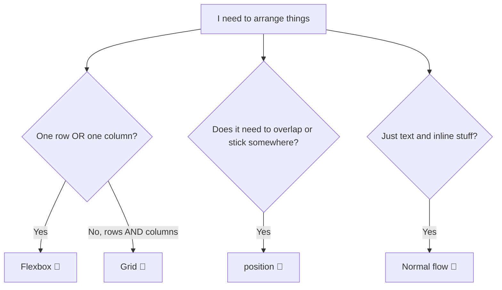

# 🏗️ Layout: Display, Position, Flexbox & Grid


> This is where the page stops being a stack of boxes and starts looking like a real design. Flexbox and Grid are the two power tools. 🔨

⬅️ Previous: [colors-and-typography.md](./colors-and-typography.md) | ➡️ Next: [responsive-design.md](./responsive-design.md)

---

## 📍 Table of Contents

1. [Which tool do I reach for?](#-which-tool-do-i-reach-for)
2. [Normal flow](#-normal-flow-the-default)
3. [Position](#-position)
4. [Flexbox](#-flexbox-one-dimension)
5. [Grid](#-grid-two-dimensions)
6. [Centering recipes](#-centering-recipes)
7. [z-index](#-z-index-stacking-order)
8. [Common layout patterns](#-common-layout-patterns)
9. [Practice](#-practice-challenges)

---

## 🧭 Which Tool Do I Reach For?



| Tool | Dimensions | Best for |
|---|---|---|
| **Normal flow** | Top to bottom | Articles, simple pages |
| **Flexbox** | 1D (row *or* column) | Navbars, button rows, centering, card rows |
| **Grid** | 2D (rows *and* columns) | Page layouts, galleries, dashboards |
| **Position** | Out-of-flow | Badges, sticky headers, tooltips, overlays |

---

## 📄 Normal Flow (The Default)

Before any layout CSS, the browser stacks block elements top to bottom and runs inline elements left to right, wrapping like text.

```
┌──────────────────────────┐
│ <header>   (block)       │
├──────────────────────────┤
│ <main>     (block)       │
│   <p> text with <a>link  │
│   <p> more text...       │
├──────────────────────────┤
│ <footer>   (block)       │
└──────────────────────────┘
```

See [`box-model.md`](./box-model.md) for `block`, `inline` and `inline-block`.

---

## 📌 Position

| Value | Behavior | Stays in flow? |
|---|---|---|
| `static` | The default. `top`/`left` etc. do nothing. | ✅ |
| `relative` | Offset from its normal spot; space is still reserved | ✅ |
| `absolute` | Placed relative to the nearest **positioned** ancestor | ❌ |
| `fixed` | Placed relative to the viewport. Stays put on scroll. | ❌ |
| `sticky` | Scrolls normally, then "sticks" at a threshold | ✅ (until stuck) |

### The classic combo: relative parent + absolute child

```css
.card { position: relative; }          /* the anchor */

.badge {
  position: absolute;                  /* positioned against .card */
  top: 8px;
  right: 8px;
}
```

```
┌─────────────────────────┐
│                   [NEW] │  ← .badge (absolute, top/right of .card)
│                         │
│   .card (relative)      │
└─────────────────────────┘
```

> ⚠️ If no ancestor is positioned, `absolute` falls back to the page itself and your badge flies off somewhere weird. 🚀

### Sticky header

```css
header {
  position: sticky;
  top: 0;          /* sticks when it reaches the top edge */
}
```

`sticky` needs a `top` (or `bottom`/`left`/`right`) value to work.

---

## 📏 Flexbox (One Dimension)

```css
.container {
  display: flex;
}
```

That one line turns the children into **flex items** laid out in a row.

### The two axes

```
flex-direction: row (default)

main axis  ──────────────────────▶
 ┌──────┐ ┌──────┐ ┌──────┐
 │  1   │ │  2   │ │  3   │        cross axis
 └──────┘ └──────┘ └──────┘             │
                                        ▼
```

| Axis | Controlled by | Direction |
|---|---|---|
| **Main** | `justify-content` | Along `flex-direction` |
| **Cross** | `align-items` | Perpendicular to main |

> 🧠 Switch to `flex-direction: column` and the axes **swap**. `justify-content` now works vertically. This confuses everyone at first.

### Container properties

| Property | Values | Effect |
|---|---|---|
| `flex-direction` | `row`, `column`, `row-reverse`, `column-reverse` | Which way items flow |
| `justify-content` | `flex-start`, `center`, `flex-end`, `space-between`, `space-around`, `space-evenly` | Spacing along the main axis |
| `align-items` | `stretch` (default), `flex-start`, `center`, `flex-end`, `baseline` | Alignment on the cross axis |
| `flex-wrap` | `nowrap` (default), `wrap` | Let items wrap to new lines |
| `gap` | `1rem` | Space between items ✅ |

### `justify-content` visualized

```
flex-start:     [1][2][3]·················
center:         ·········[1][2][3]·········
flex-end:       ·················[1][2][3]
space-between:  [1]········[2]········[3]
space-around:   ·[1]·····[2]·····[3]·
space-evenly:   ··[1]····[2]····[3]··
```

### Item properties

| Property | What it does |
|---|---|
| `flex-grow` | How much extra space the item takes (`1` = share equally) |
| `flex-shrink` | How willing it is to shrink when space is tight |
| `flex-basis` | Starting size before growing/shrinking |
| `flex` | Shorthand: `flex: 1` = grow 1, shrink 1, basis 0 |
| `align-self` | Override `align-items` for just this item |
| `order` | Change visual order (careful, it doesn't change the tab order!) |

```css
.sidebar { flex: 0 0 250px; }   /* fixed 250px, no growing or shrinking */
.content { flex: 1; }           /* takes whatever is left */
```

### Example: a navbar

```html
<nav class="nav">
  <a class="logo" href="#">SPECULIAN</a>
  <ul class="links">
    <li><a href="#">Home</a></li>
    <li><a href="#">Work</a></li>
    <li><a href="#">Contact</a></li>
  </ul>
</nav>
```

```css
.nav {
  display: flex;
  justify-content: space-between;   /* logo left, links right */
  align-items: center;              /* vertically centered */
  padding: 1rem 2rem;
}

.links {
  display: flex;
  gap: 1.5rem;
  list-style: none;
}
```

---

## 🔲 Grid (Two Dimensions)

```css
.gallery {
  display: grid;
  grid-template-columns: repeat(3, 1fr);   /* 3 equal columns */
  gap: 1rem;
}
```

```
┌────────┬────────┬────────┐
│   1    │   2    │   3    │   ← row 1
├────────┼────────┼────────┤
│   4    │   5    │   6    │   ← row 2
└────────┴────────┴────────┘
   col 1    col 2    col 3
```

### Key grid vocabulary

| Term | Meaning |
|---|---|
| **Track** | A row or a column |
| **Cell** | One intersection of a row and column |
| **Area** | A rectangle made of multiple cells |
| **Gap** | Space between tracks |
| **`fr`** | "Fraction of the free space" |
| **Line** | The dividers between tracks (numbered from 1) |

### Defining columns

| You write | Result |
|---|---|
| `repeat(3, 1fr)` | 3 equal columns |
| `200px 1fr` | Fixed sidebar + flexible content |
| `1fr 2fr 1fr` | Middle column twice as wide |
| `repeat(auto-fit, minmax(220px, 1fr))` | **Responsive** columns, no media query needed ✨ |

```css
.cards {
  display: grid;
  grid-template-columns: repeat(auto-fit, minmax(220px, 1fr));
  gap: 1.5rem;
}
```

> 🎯 That `auto-fit` + `minmax` line: "fit as many columns of at least 220px as will fit, and stretch them to fill the row."

### Spanning cells

```css
.featured {
  grid-column: span 2;   /* take 2 columns */
}
```

### Named areas: draw your layout in code 🖍️

```css
.page {
  display: grid;
  grid-template-columns: 220px 1fr;
  grid-template-areas:
    "header  header"
    "sidebar main"
    "footer  footer";
  gap: 1rem;
  min-height: 100vh;
}

header  { grid-area: header; }
aside   { grid-area: sidebar; }
main    { grid-area: main; }
footer  { grid-area: footer; }
```

```
┌──────────────────────────────┐
│           header             │
├────────────┬─────────────────┤
│  sidebar   │      main       │
├────────────┴─────────────────┤
│           footer             │
└──────────────────────────────┘
```

### Alignment in grid

| Property | Applies to | Controls |
|---|---|---|
| `justify-items` / `align-items` | Container | Item alignment inside **each cell** |
| `justify-content` / `align-content` | Container | The whole grid inside the container |
| `justify-self` / `align-self` | One item | Just that item |
| `place-items: center` | Container | Shorthand for both centering directions |

---

## 🎯 Centering Recipes

The famous "how do I center a div" question, solved. 🥳

| Goal | Recipe |
|---|---|
| Center a block horizontally | `margin: 0 auto;` (needs a `width` or `max-width`) |
| Center text | `text-align: center;` |
| Center anything both ways (Flexbox) | `display: flex; justify-content: center; align-items: center;` |
| Center anything both ways (Grid) | `display: grid; place-items: center;` |

```css
.hero {
  display: grid;
  place-items: center;
  min-height: 100vh;
}
```

---

## 🥞 z-index: Stacking Order

When positioned elements overlap, `z-index` decides who's on top.

```
z-index: 3  ┌────────┐
          ┌─┴──────┐ │   ← z-index: 2
        ┌─┴──────┐ │ │
        │  z: 1  │ │─┘
        └────────┘─┘
```

- Higher number = closer to you 👀
- Only works on **positioned** elements (anything but `static`) and on flex/grid items
- Stacking contexts can trap you: a child with `z-index: 9999` can't escape a parent that sits below another element
- Keep a small scale (1, 10, 100) instead of racing to 99999

---

## 🧩 Common Layout Patterns

| Pattern | Tool | Key lines |
|---|---|---|
| Navbar | Flexbox | `justify-content: space-between; align-items: center;` |
| Sticky footer | Flex column | `body { display: flex; flex-direction: column; min-height: 100vh; } main { flex: 1; }` |
| Card gallery | Grid | `repeat(auto-fit, minmax(220px, 1fr))` |
| Holy-grail page | Grid areas | header / sidebar / main / footer |
| Overlay badge | Position | relative parent + absolute child |
| Modal backdrop | Position | `position: fixed; inset: 0;` |

---

## 🏋️ Practice Challenges

- [ ] **Level 1:** Center a box on the screen using Flexbox, then again using Grid
- [ ] **Level 2:** Build a navbar with a logo on the left and links on the right
- [ ] **Level 3:** Make a row of 3 cards that wrap on small screens (`flex-wrap`)
- [ ] **Level 4:** Build a 3-column gallery with `repeat(auto-fit, minmax(...))`
- [ ] **Level 5:** Recreate the header / sidebar / main / footer page with `grid-template-areas`
- [ ] **Boss:** Add a sticky header and a badge using `position`

---

## ✅ Checklist: "Did It Click?"

- [ ] I can say when to use Flexbox vs Grid
- [ ] I know which axis `justify-content` controls (and how `column` swaps it)
- [ ] I can explain `relative` parent + `absolute` child
- [ ] I can write a responsive grid with `auto-fit` and `minmax`
- [ ] I can center something without googling

⬅️ Previous: [colors-and-typography.md](./colors-and-typography.md) | ➡️ Next: [responsive-design.md](./responsive-design.md)
